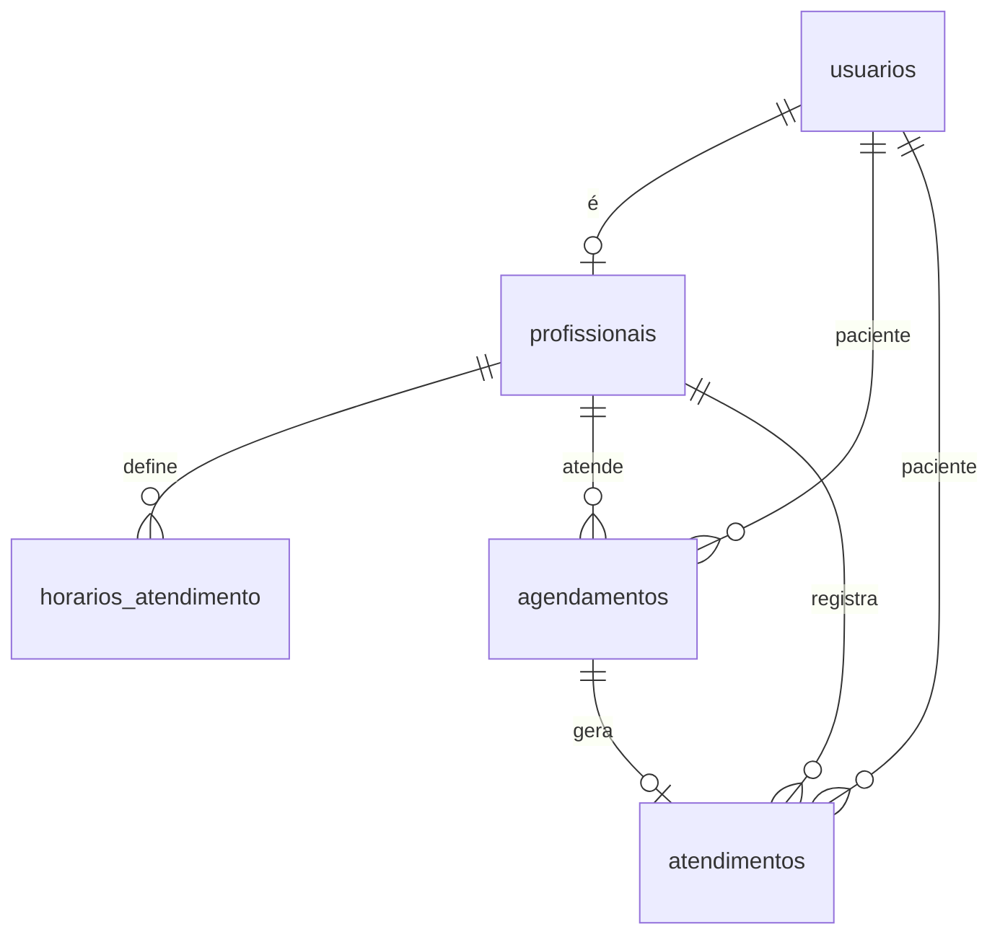
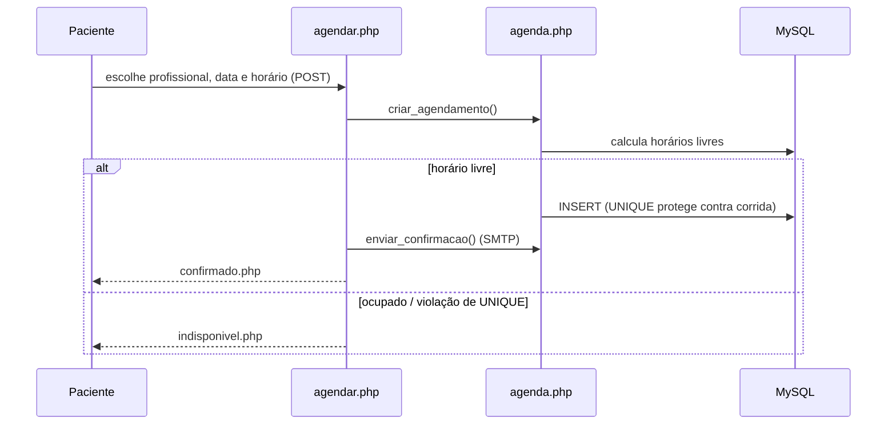

# Arquitetura

## Visão geral
Aplicação PHP em camadas simples, sem framework. Cada página em `public/` trata a requisição (GET/POST), usa as regras de `includes/` e devolve HTML.

```
Navegador ──► public/*.php ──► includes/bootstrap.php (sessão, CSRF, acesso)
                         ├───► includes/agenda.php     (regras de agenda)
                         ├───► includes/pacientes.php  (validação)
                         ├───► includes/mailer.php     (SMTP)
                         └───► includes/ui.php         (HTML compartilhado)
                                      │
                                      ▼
                                MySQL (PDO)
```

Convenções do código:
- Toda página começa com `require` do `bootstrap.php` e, quando restrita, chama `exigir_perfil(...)`.
- Todo `POST` valida o token CSRF (`csrf_check()`) e termina com redirecionamento (padrão *Post/Redirect/Get*).
- Toda saída vinda do usuário ou do banco passa por `e()`.
- Mensagens para o usuário usam `flash()`.

## Requisitos × código

| Req. | Descrição | Onde |
|---|---|---|
| R01 | Cadastro e login por perfil | `cadastro.php`, `index.php`, `includes/bootstrap.php` |
| R02 | Horários de atendimento do profissional | `profissional_horarios.php` |
| R03 | Agendamento em 3 passos | `agendar.php`, `includes/agenda.php` |
| R04 | Bloqueio de horário ocupado | `agenda.php` (`criar_agendamento`), `UNIQUE` em `agendamentos` |
| R05 | Confirmação por e-mail | `agenda.php` (`enviar_confirmacao`), `mailer.php` |
| R06 | Cancelar e reagendar | `minhas_consultas.php`, `historico_paciente.php`, `recepcao_agendar.php` |
| R07 | Registro e histórico de atendimentos | `profissional_agenda.php`, `historico_paciente.php`, tabela `atendimentos` |
| R08 | Painel da recepção | `painel.php`, `pacientes.php`, `recepcao_agendar.php`, `editar_paciente.php` |
| R09 | Segurança e privacidade | CSRF, `password_hash`, perfis, consentimento LGPD |
| R10 | Interface responsiva | `public/assets/style.css` (mobile para paciente; desktop a partir de 960 px) |

## Modelo de dados



| Tabela | Conteúdo |
|---|---|
| `usuarios` | Pacientes, profissionais e recepção (`perfil`). Dados do paciente: telefone, data de nascimento, convênio, observação geral. `consentimento_lgpd_em` registra o aceite |
| `profissionais` | Especialidade; 1:1 com um usuário de perfil `profissional` |
| `horarios_atendimento` | Janelas semanais (dia da semana, início, fim, duração da consulta) |
| `agendamentos` | Consulta marcada: paciente, profissional, data/hora, duração, tipo, status (`agendado`, `cancelado`, `realizado`, `faltou`) |
| `atendimentos` | Histórico: descrição registrada pelo profissional após a consulta |

## Prevenção de conflitos de horário (R04)

Duas barreiras independentes:

1. **Servidor** (`criar_agendamento` em `includes/agenda.php`): recalcula os horários livres do profissional naquele dia e só aceita o horário se ele estiver livre *naquele momento*. Isso impede, por exemplo, usar uma tela antiga.
2. **Banco de dados**: a tabela `agendamentos` tem uma coluna gerada que só vale enquanto a consulta está ativa, e uma restrição de unicidade sobre ela:

```sql
slot_ativo DATETIME GENERATED ALWAYS AS (IF(status = 'agendado', data_hora, NULL)) STORED,
UNIQUE KEY uq_profissional_slot (profissional_id, slot_ativo)
```

Como `NULL` não conflita com `NULL` em índices únicos, consultas canceladas, realizadas ou com falta liberam o horário, e duas requisições simultâneas para o mesmo horário não conseguem gravar as duas: a segunda recebe erro `23000`, tratado como "Horário indisponível".

## Fluxo de agendamento



## Segurança

| Ameaça | Medida |
|---|---|
| Senhas expostas | `password_hash` / `password_verify` (bcrypt) |
| SQL injection | PDO com *prepared statements* em todas as consultas |
| XSS | `e()` (`htmlspecialchars`) em toda saída |
| CSRF | Token por sessão em todos os formulários de escrita |
| Fixação de sessão | `session_regenerate_id` no login; cookie `HttpOnly`, `SameSite=Lax`, `Secure` em HTTPS |
| Acesso indevido | `exigir_perfil()` no topo de cada página restrita; ações validam que o registro pertence ao usuário |
| Vazamento de arquivos | `.htaccess` bloqueia `includes/`, `storage/`, `database/` e `config.php` |
| Credenciais no Git | `config.php` está no `.gitignore`; o repositório traz só `config.example.php` |
| Dados pessoais (LGPD) | Consentimento registrado; dados de teste fictícios |

## E-mail (R05)
`includes/mailer.php` fala SMTP direto (SSL na 465 ou STARTTLS na 587, `AUTH LOGIN`). Sem `smtp_host`, usa o `mail()` do PHP. Cada envio é registrado em `storage/emails.log` (data, destinatário e resultado, sem senhas). A mensagem é informativa: não há confirmação de presença pelo paciente.

## Ambientes
`config.php` contém os blocos `$local` e `$producao`; o sistema escolhe pelo nome do servidor (`localhost`, `127.0.0.1`, `*.local`, `*.test` = local). A URL base é descoberta automaticamente, então funciona em subpasta (ex.: `/agenda_clinica`). O fuso do MySQL é fixado em `-03:00` para coincidir com o do PHP.

## Como estender
- **Novo tipo de atendimento:** ajuste o `ENUM` de `tipo` (tabelas `agendamentos` e `atendimentos`) e a constante `TIPOS` em `includes/agenda.php`.
- **Nova opção de convênio:** edite `CONVENIOS` em `includes/pacientes.php`.
- **Nova página restrita:** copie uma página existente, mantenha `require bootstrap`, `exigir_perfil()`, `csrf_check()` nos POST e `e()` nas saídas.
